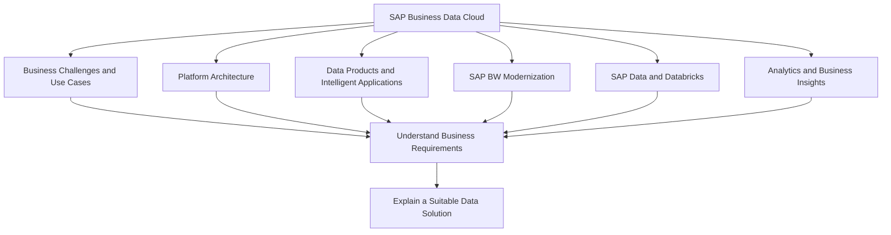
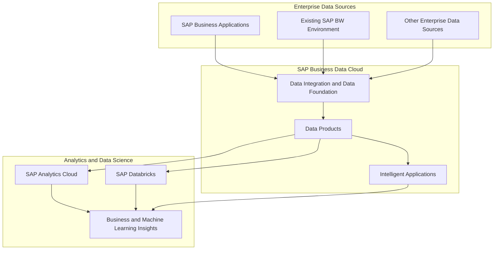
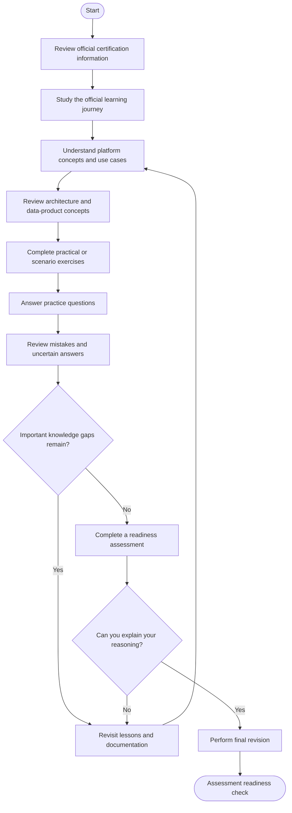
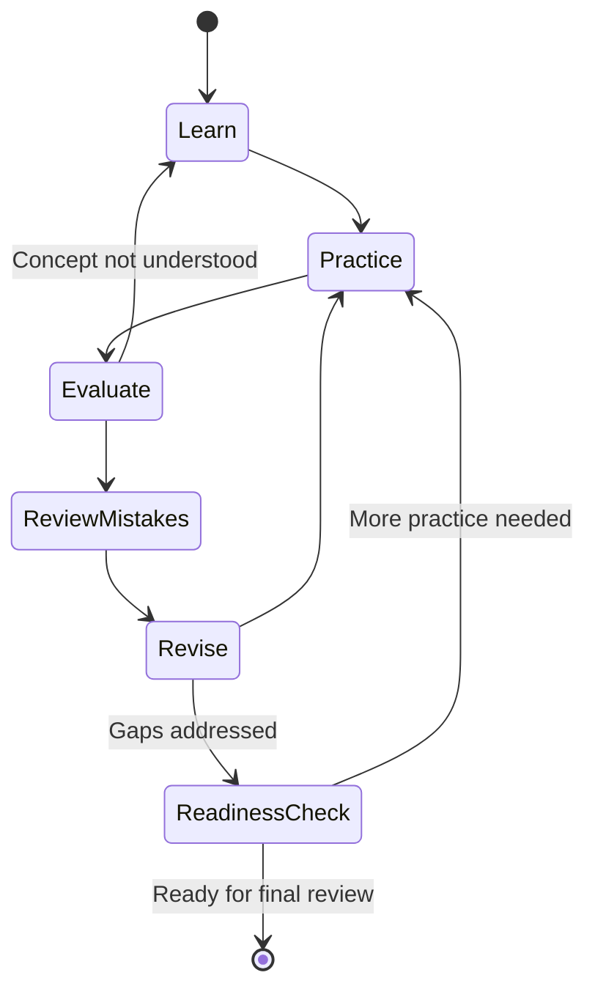
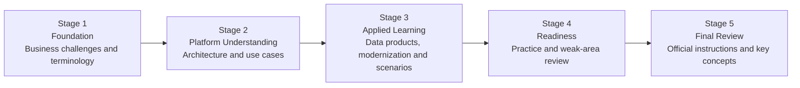

# SAP Business Data Cloud — C_BCBDC Study Guide

A practical, community-focused study guide for the **SAP Certified – SAP Business Data Cloud (C_BCBDC)** certification. This repository helps learners understand SAP Business Data Cloud, enterprise data architecture, data products, analytics, SAP BW modernization, and the relationship between SAP data and data science capabilities.

The guide combines official learning resources with architecture diagrams, a structured preparation roadmap, original practice scenarios, and hands-on project ideas.

> **Certification version:** CertsGate lists this certification as `C_BCBDC_2511`. SAP's current certification page identifies the exam as `C_BCBDC`. Always verify the current certification details and assessment requirements on SAP Learning before scheduling your assessment.

## Table of Contents

- [Overview](#overview)
- [About the Certification](#about-the-certification)
- [Who Should Prepare?](#who-should-prepare)
- [Skills and Knowledge Areas](#skills-and-knowledge-areas)
- [Official Learning Objectives](#official-learning-objectives)
- [Conceptual Skills Map](#conceptual-skills-map)
- [SAP Business Data Cloud Architecture](#sap-business-data-cloud-architecture)
- [Certification Preparation Flowchart](#certification-preparation-flowchart)
- [Circular Study and Revision Cycle](#circular-study-and-revision-cycle)
- [Step-by-Step Preparation Guide](#step-by-step-preparation-guide)
- [Study Roadmap](#study-roadmap)
- [Practice Questions and Scenario Exercises](#practice-questions-and-scenario-exercises)
- [Hands-On Projects](#hands-on-projects)
- [Common Preparation Mistakes](#common-preparation-mistakes)
- [Career Relevance](#career-relevance)
- [Frequently Asked Questions](#frequently-asked-questions)
- [Official and Additional Learning Resources](#official-and-additional-learning-resources)
- [About CertsGate](#about-certsgate)

## Overview

Business data is often spread across enterprise applications, data warehouses, analytical platforms, and external systems. Bringing that information together in a useful and governed way can be difficult, especially when teams need consistent business meaning and timely insights.

**SAP Business Data Cloud** is designed to help organizations connect SAP data capabilities, data products, analytics, and intelligent applications. Understanding the platform involves more than learning product names: candidates should be able to explain the business problems it addresses, recognize relevant use cases, and understand its architecture at a foundational level.

This repository supports **C_BCBDC preparation** through clear explanations, independent study recommendations, and scenario-based exercises.

The primary starting point is SAP's official learning journey:

**[Exploring SAP Business Data Cloud](https://learning.sap.com/learning-journeys/exploring-sap-business-data-cloud)**

## About the Certification

The **SAP Certified – SAP Business Data Cloud** certification validates foundational knowledge of SAP Business Data Cloud and the skills needed to contribute as part of a project team.

SAP currently lists the following assessment information on its certification page:

| Item | Official information |
|---|---|
| Certification name | SAP Certified – SAP Business Data Cloud |
| Exam code | C_BCBDC |
| Provider | SAP |
| Assessment type | Scenario-based assessment |
| Duration | 2 hours |
| Passing score | 60% |
| Recommended learning resource | Exploring SAP Business Data Cloud |

Source: [Official SAP certification page](https://learning.sap.com/certifications/sap-certified-associate-sap-business-data-cloud).

Assessment instructions and technical requirements can change. Recheck the official page before your assessment, including the current format, system requirements, and any applicable subscription or attempt requirements.

## Who Should Prepare?

This certification may be useful for:

- Data analysts who work with SAP business data and reporting.
- Consultants involved in data strategy or SAP analytics projects.
- Business users who need to understand SAP data capabilities.
- Data and analytics professionals exploring SAP's data ecosystem.
- SAP professionals involved in data integration, warehouse modernization, or intelligent applications.
- Project team members who need a foundational understanding of SAP Business Data Cloud.

SAP's official learning journey lists no prerequisites. However, familiarity with enterprise data, reporting, analytics, or SAP business applications can make the material easier to understand.

If you are new to the topic, begin with the business problems that the platform addresses before exploring its architecture and use cases.

## Skills and Knowledge Areas

The official learning journey, *Exploring SAP Business Data Cloud*, identifies several learning outcomes. These provide a useful foundation for organizing your preparation.

### 1. Business challenges and use cases

Understand the types of data challenges SAP Business Data Cloud is intended to address. Consider how organizations use data from different business functions to support reporting, analysis, and decision-making.

When reviewing a use case, identify the business problem first. Then determine what data is needed, where it comes from, and how it should be consumed.

### 2. SAP Business Data Cloud architecture

Learn the platform's architectural purpose and how its capabilities support data management, analytics, and intelligent applications.

Practice explaining the relationships between components rather than memorizing isolated definitions.

### 3. Data products and intelligent applications

Understand the role of data products in making useful, contextualized data available for consumption. Explore how intelligent applications use data to support specific business needs.

Ask yourself what a data consumer needs, how the information is described, and how it can be reused.

### 4. SAP BW modernization

Review the learning journey's coverage of the path to SAP BW modernization using SAP Business Data Cloud.

Focus on why organizations may modernize existing data warehouse environments, what architectural considerations matter, and how the modernization approach relates to current business requirements.

Avoid assuming that every organization should follow an identical migration path.

### 5. SAP Databricks and machine learning insights

Explore how SAP data can be shared with SAP Databricks for developing machine learning insights. Understand the high-level relationship between enterprise data and analytical or data science workflows.

Consider data access, governance, intended use, and the business question the analysis is meant to answer.

### 6. SAP analytics capabilities

Review how analytical tools and data capabilities contribute to reporting and decision support. Learn to distinguish between making data available, analyzing it, and presenting the resulting information to business users.

## Official Learning Objectives

SAP's official learning journey identifies the following outcomes:

- Describe the business challenges that SAP Business Data Cloud addresses.
- Identify use cases for SAP Business Data Cloud.
- Outline SAP Business Data Cloud architecture.
- Describe the path to SAP BW modernization using SAP Business Data Cloud.
- Discover, install, and extend intelligent applications and data products.
- Share SAP data with SAP Databricks to develop machine learning insights.

These are learning-journey outcomes, not a claim that SAP publishes an exam blueprint with exactly these six weighted domains.

For the latest details, consult:

- [SAP C_BCBDC certification page](https://learning.sap.com/certifications/sap-certified-associate-sap-business-data-cloud)
- [Exploring SAP Business Data Cloud learning journey](https://learning.sap.com/learning-journeys/exploring-sap-business-data-cloud)

## Conceptual Skills Map

SAP's public certification page does not provide domain percentages in the information used for this guide. The following map organizes relevant learning themes without assigning numerical weights.

**This is an independent study overview, not official exam weighting.**

Use this map as a checklist. After studying each area, explain its purpose, give a business example, and describe how it relates to the wider platform.

## SAP Business Data Cloud Architecture

The architecture of a data platform is easier to understand when viewed through the movement and use of information. Organizations need to make relevant data available, preserve its meaning, and provide appropriate access for analytics and other applications.

The following diagram is a **conceptual learning illustration**. It shows possible relationships among data sources, SAP Business Data Cloud capabilities, and data consumers. It is not an official SAP reference architecture and does not prescribe a mandatory implementation.

### How to read the architecture

- **Enterprise data sources:** Business applications and existing data environments hold information used by the organization.
- **Data foundation:** Data must be made available through suitable integration and platform capabilities.
- **Data products:** Data is organized for consumption in a way that supports meaningful reuse.
- **Intelligent applications:** Application capabilities use data to address particular business needs.
- **Analytics and data science:** Tools can help users explore data, report on performance, and develop further insights.

The actual services and data flows depend on the organization's landscape and the capabilities supported by its chosen solution.

### Architecture questions to practice

When reviewing a data scenario, ask:

1. What business question needs to be answered?
2. Which source systems hold the relevant information?
3. What data needs to be combined or contextualized?
4. How should the data be made available for reuse?
5. Who will consume the data: a business user, an analytical application, or a data scientist?
6. What governance, access, and quality considerations apply?
7. How would the proposed design support the required business outcome?

## Certification Preparation Flowchart

Follow a repeatable process instead of relying on a single round of reading. If you discover an important knowledge gap, revisit the corresponding lesson and repeat the exercise before proceeding.

This flowchart is a preparation recommendation. It does not reproduce SAP's official assessment workflow.

## Circular Study and Revision Cycle

Scenario-based preparation requires more than remembering terminology. You should be able to apply concepts to a business situation and explain the reasoning behind your response.

Use the cycle as follows:

- **Learn:** Study one topic from SAP's learning journey.
- **Practice:** Apply the concept to a business data scenario.
- **Evaluate:** Check whether your explanation addresses the requirements.
- **Review mistakes:** Identify incorrect assumptions or missing details.
- **Revise:** Revisit the relevant learning material.
- **Practice again:** Test whether you can apply the concept to a different scenario.

Repeat the cycle until you can explain the concepts without relying entirely on notes.

## Step-by-Step Preparation Guide

### Step 1: Read the official certification page

Start with the [SAP C_BCBDC certification page](https://learning.sap.com/certifications/sap-certified-associate-sap-business-data-cloud).

Confirm the assessment duration, passing score, assessment type, and technical requirements. Keep a note of the date you checked these details because certification information may change.

### Step 2: Complete the official learning journey

Work through [Exploring SAP Business Data Cloud](https://learning.sap.com/learning-journeys/exploring-sap-business-data-cloud).

Organize your notes around the stated outcomes: business challenges, use cases, architecture, SAP BW modernization, data products, intelligent applications, and SAP Databricks.

### Step 3: Connect features to business problems

For every capability you study, write down:

- The business problem it addresses.
- The data or information involved.
- The users or applications that consume the result.
- The relevant architectural relationships.
- Any assumptions that would need confirmation in a real implementation.

This method helps you develop an explanation rather than memorize disconnected facts.

### Step 4: Review the architecture

Redraw the conceptual architecture from memory. Explain where data originates, how it becomes available for consumption, and how different users or tools may use it.

Use SAP's official documentation to verify product-specific relationships and terminology.

### Step 5: Explore modernization and data-product scenarios

Consider an organization with an existing data warehouse and several reporting requirements. Identify the business reasons for modernization, the information that must remain useful, and the possible role of data products in supporting new use cases.

Avoid treating modernization as a simple product replacement. It is an architecture and business decision that depends on the existing landscape.

### Step 6: Practice explaining solutions

Use original scenarios and practice questions to identify weak areas. Explain why your response fits the business requirement and which assumptions influence your conclusion.

For every incorrect answer, record the topic, the misunderstanding, and the learning material you need to revisit.

### Step 7: Check assessment readiness

Before taking the assessment, confirm that you can:

- Explain the business challenges addressed by SAP Business Data Cloud.
- Describe its architecture at a foundational level.
- Identify appropriate data-product and intelligent-application use cases.
- Explain the purpose of SAP BW modernization.
- Describe the relationship between SAP data and SAP Databricks at a high level.
- Reason through unfamiliar scenarios instead of relying on memorized answers.

## Study Roadmap

This roadmap is a flexible independent study plan, not an official SAP timetable. Adjust it to your background and available study time.

| Stage | Study focus | Suggested output |
|---|---|---|
| 1. Foundation | Business data challenges and platform terminology | A glossary in your own words |
| 2. Platform understanding | Architecture and use cases | A redrawn architecture diagram |
| 3. Applied learning | Data products, intelligent applications, modernization, and data science | Scenario notes and comparison tables |
| 4. Readiness | Practice questions and mistake analysis | A list of remaining knowledge gaps |
| 5. Final review | Official learning outcomes and assessment requirements | A final revision checklist |

### Example weekly routine

| Session | Activity |
|---|---|
| 1 | Study one section of the official learning journey |
| 2 | Summarize key concepts and business use cases |
| 3 | Review architecture and draw a diagram |
| 4 | Work through a practical or scenario exercise |
| 5 | Answer practice questions and analyze mistakes |
| 6 | Revisit weak topics and try a new scenario |
| 7 | Review progress and plan the next cycle |

This schedule is only a planning aid. Your progress should be measured by your understanding, not by the number of sessions completed.

## Practice Questions and Scenario Exercises

Practice questions are useful when they help you identify what you understand and what needs more work. They should reinforce the official learning journey rather than replace it.

The following questions are **original educational exercises**, not official SAP exam questions.

### Question 1: Understanding the business problem

An organization has data across several business applications. Different departments struggle to use consistent information for reporting and analysis.

What should a team investigate first?

A. Which business questions and data requirements need to be addressed.  
B. How to purchase additional tools before defining the problem.  
C. How to remove all existing data sources immediately.  
D. How to build a dashboard without examining the data.

**Explanation:** A is the most appropriate starting point. Architecture choices should follow the business requirements, data sources, and intended consumers.

### Question 2: Understanding data products

A team wants business users and applications to consume relevant data in a consistent, reusable way.

Which concept is most directly relevant to investigating this requirement?

A. Data products and how they make data available for consumption.  
B. Replacing every source application with a reporting tool.  
C. Ignoring the meaning and context of the data.  
D. Keeping all information isolated from potential consumers.

**Explanation:** A is the best fit among the options. In a real implementation, the team would also verify the required data, governance, and supported capabilities.

### Question 3: SAP BW modernization

An organization is reviewing its existing SAP BW landscape and considering a modernization approach.

Which factors should influence the discussion?

- Existing architecture and data dependencies.
- Business and reporting requirements.
- Target capabilities and supported modernization paths.
- Migration risks, governance, and operational needs.

**Explanation:** Modernization requires a review of business and technical requirements. Do not assume that one approach is suitable for every organization.

### Question 4: Data science and machine learning

A data team wants to use SAP data to develop machine learning insights using SAP Databricks.

What should the team clarify before designing the solution?

- Which data is needed and where it originates.
- How the data can be made available through supported capabilities.
- What the analytical use case is intended to achieve.
- Which access, governance, and quality requirements apply.

**Explanation:** The design should connect the data requirements to the intended analytical outcome and verify the relevant technical and governance constraints.

### How to use practice questions effectively

After each question:

1. Explain why your answer fits the scenario.
2. Identify the requirement that matters most.
3. Explain why the other options are unsuitable.
4. Map uncertainty or mistakes to the official learning outcomes.
5. Revisit the relevant lesson and attempt a different scenario.
6. Use a mock test or structured readiness exercise to identify remaining gaps.

For additional independent preparation material, visit [CertsGate's SAP certification resources](https://certsgate.com/exams/sap). Verify technical details against SAP's official resources.

## Hands-On Projects

These projects help you connect foundational knowledge to realistic business situations. They are independent learning exercises, not mandatory SAP certification tasks.

### Project 1: Map an enterprise data use case

**Goal:** Understand how a business question translates into data requirements.

Tasks:

1. Choose a fictional business scenario, such as sales reporting across several regions.
2. Identify the business question and the intended users.
3. List the source systems and required information.
4. Draw a high-level data architecture.
5. Explain how the resulting information would support the business decision.

**Deliverable:** A one-page use-case description and a Mermaid architecture diagram.

### Project 2: Design a data-product use case

**Goal:** Explore the role of reusable data in an analytical solution.

Tasks:

1. Define a fictional business requirement.
2. Identify the information needed to address it.
3. Describe the intended consumers of the data.
4. Explain how context, quality, access, and reuse affect the design.
5. Identify which SAP documentation you would consult to validate the proposed approach.

**Deliverable:** A data-product concept note with assumptions and open questions.

### Project 3: Analyze a BW modernization scenario

**Goal:** Practice discussing modernization in terms of business and technical requirements.

Tasks:

1. Describe a fictional existing data warehouse environment.
2. Identify current reporting needs and data dependencies.
3. List the business goals for modernization.
4. Compare possible approaches without assuming that one is automatically correct.
5. Document the risks, dependencies, and questions that need further investigation.

**Deliverable:** A comparison table and a short architecture decision record.

## Common Preparation Mistakes

### Memorizing terminology without understanding use cases

Being able to define a term is useful, but you should also explain why the concept matters and when it might be applied.

### Treating every data problem as a reporting problem

Business data solutions may involve integration, data products, modernization, analytics, or data science. Identify the underlying requirement before choosing a capability.

### Confusing a conceptual diagram with a product specification

Architecture diagrams in this repository are learning aids. Use SAP documentation to confirm current product capabilities, supported integrations, and implementation requirements.

### Ignoring SAP BW modernization

The official learning journey includes the path to SAP BW modernization using SAP Business Data Cloud. Include it in your preparation rather than focusing exclusively on analytics terminology.

### Using practice questions to memorize answers

Repeatedly seeing a question can create familiarity without understanding. Practice explaining the reasoning and apply the concept to a new scenario.

### Trusting outdated exam details

Exam duration, assessment requirements, and other certification information can change. Verify current details on SAP's certification page before your assessment.

## Career Relevance

Foundational knowledge of SAP Business Data Cloud can support work involving:

- Enterprise data and analytics.
- SAP data architecture.
- Data strategy and modernization projects.
- Business intelligence and reporting.
- SAP consulting and project delivery.
- Data products and analytical use cases.
- Collaboration between business users, data analysts, and technical teams.

Certification can help demonstrate structured learning, but it does not replace practical experience or deeper technical expertise. Its value depends on how well you apply the knowledge to real business requirements.

## Frequently Asked Questions

### What is the C_BCBDC certification?

C_BCBDC is the exam code for SAP Certified – SAP Business Data Cloud. SAP describes it as a certification that validates foundational knowledge of SAP Business Data Cloud.

### How long is the C_BCBDC assessment?

SAP's current certification page lists a duration of **2 hours**. Confirm the latest details on the [official certification page](https://learning.sap.com/certifications/sap-certified-associate-sap-business-data-cloud) before taking the assessment.

### What is the passing score?

SAP currently lists a passing score of **60%** for C_BCBDC. Check the official page again in case requirements change.

### What type of assessment does SAP use?

The current certification page identifies the assessment type as **scenario-based**. Review SAP's instructions and available preparation tools to understand the current assessment experience.

### What should I study for C_BCBDC?

Start with the official *Exploring SAP Business Data Cloud* learning journey. Its outcomes cover business challenges, use cases, architecture, SAP BW modernization, intelligent applications, data products, and SAP Databricks.

### Are the practice questions in this repository official?

No. The questions and projects in this repository are original educational exercises. They are not represented as official SAP questions or as copies of assessment content.

### How long should I study?

The time required depends on your familiarity with SAP data concepts and enterprise analytics. Follow the learning journey, practice explaining the concepts, and spend additional time on areas where your reasoning is weak.

### Does this study guide guarantee a passing result?

No. This repository supports learning but cannot guarantee an assessment outcome. Use official resources, practical exercises, and readiness checks to evaluate your understanding.

## Official and Additional Learning Resources

Use SAP's resources as the primary source for certification and technical information.

| Resource | Purpose |
|---|---|
| [SAP C_BCBDC Certification Page](https://learning.sap.com/certifications/sap-certified-associate-sap-business-data-cloud) | Current certification name, exam code, duration, passing score, and assessment type |
| [Exploring SAP Business Data Cloud](https://learning.sap.com/learning-journeys/exploring-sap-business-data-cloud) | Official learning journey and its stated learning outcomes |
| [SAP Learning](https://learning.sap.com/) | Search for relevant learning journeys, courses, and certification information |
| [SAP Help Portal](https://help.sap.com/) | Product documentation and technical guidance |
| [SAP Discovery Center](https://discovery-center.cloud.sap/) | Explore SAP cloud capabilities, use cases, and guided missions |
| [SAP Architecture Center](https://architecture.learning.sap.com/) | Review SAP architecture guidance and reference architectures |
| [SAP Certification Support](https://learning.sap.com/helpcenter/certification-support) | Certification preparation, assessment guidance, and support |
| [CertsGate SAP Resources](https://certsgate.com/exams/sap) | Independent supplementary certification-preparation material |

Before scheduling the assessment, confirm the current instructions, technical readiness requirements, available attempts, and any subscription requirements on SAP's official pages.

## About CertsGate

[CertsGate](https://certsgate.com/) is an independent IT certification preparation resource. Its [SAP exam catalog](https://certsgate.com/exams/sap) can help learners discover supplementary preparation material.

For C_BCBDC, use third-party resources to reinforce your understanding, check your knowledge, and identify topics for further review. Compare technical claims with SAP documentation and keep the official learning journey at the center of your preparation.
